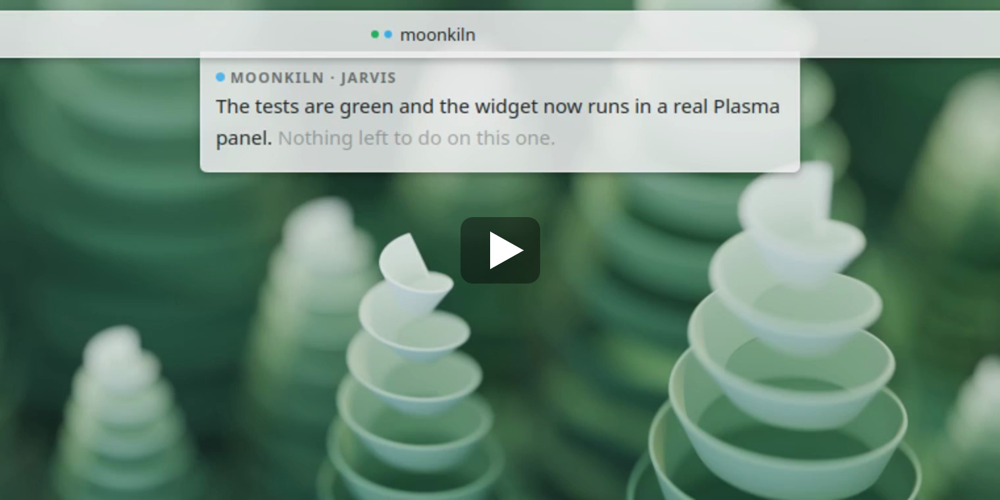
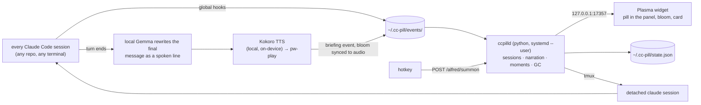

<div align="center">

<a href="linux/docs/cc-pill-kde-demo.mp4"></a>

<sub><b>▶ Watch the 2½-minute demo</b> · every state, the bloom, the card, the settings, placement and the hotkey, narrated by the pill's own voice</sub>

# cc-pill for KDE Plasma

**A living panel widget for [Claude Code](https://claude.com/claude-code).**

Every Claude Code session on the machine at a glance, in your Plasma panel, in your panel's own font and colours. Live narration of what Claude is doing, an amber "needs you" when it wants permission, and a local neural voice that briefs you in one to three sentences when each turn finishes, blooming the words off the panel as it speaks. Press a hotkey to ask your assistant what is going on, or to pass a message to one session; type it, or hold Space and say it.

*Built for people who run Claude Code while doing other things.*


*Looking for the macOS version? It lives on the [`main`](https://github.com/ambasoma/cc-pill/tree/main) branch.*

</div>

---

cc-pill grew out of running [Moon Kiln](https://moonkiln.com), my handmade clay store, with Claude Code: answering customers, managing orders, printing shipping labels, updating the storefront, planning the work in Linear. Sessions run all day while my hands are busy with clay, and I wanted to know what Claude was up to, and be asked for what it needs, without sitting at a screen. So: a widget that watches every session from the panel, a voice that briefs me when something finishes, and a hotkey to hand Claude the next job. It is a proper Plasma widget: it follows your colour scheme, sits wherever you put it on any panel, and keeps one width while the traces stream so the rest of your panel never shuffles.

## The pill


The widget is the signal. One dot per session in the colour scheme's accent, neutral and positive colours; words in the panel's font.

<table align="center">
  <tr>
    <td align="center">
      <br>
      <sub><b>Working.</b> Live narration of what Claude is doing, in a fixed-width slot that never shoves its neighbours.</sub>
    </td>
    <td align="center">
      <br>
      <sub><b>Needs you.</b> A real permission prompt: the scheme's neutral colour and a pulsing dot.</sub>
    </td>
  </tr>
  <tr>
    <td align="center">
      <br>
      <sub><b>Briefing.</b> A window blooms off the panel as the voice starts; the words light up as they are spoken.</sub>
    </td>
    <td align="center">
      <br>
      <sub><b>No sessions.</b> A faint dot keeps the widget findable and clickable (or hide it entirely).</sub>
    </td>
  </tr>
  <tr>
    <td align="center">
      <br>
      <sub><b>The card.</b> Click the pill: one row per session, its last briefing, replay and send-a-prompt buttons, a pin to keep it open, mute.</sub>
    </td>
    <td align="center">
      <br>
      <sub><b>The peek.</b> Hover (optional): the same card in a window that takes no keyboard focus, so it never interrupts typing.</sub>
    </td>
  </tr>
  <tr>
    <td align="center">
      <br>
      <sub><b>Porcelain.</b> cc-pill's original look (cream by day, kiln at night, sun and moon, tapping paw), one setting away.</sub>
    </td>
    <td align="center">
      <br>
      <sub><b>Custom.</b> Your own font, colours, capsule, border and corner radius.</sub>
    </td>
  </tr>
</table>

## What it does

- **Every session.** Keyed by Claude Code's real lifecycle hooks, dead sessions reaped automatically, SSH sessions tagged. One dot each.
- **Live narration.** While Claude works the pill alternates between the project name and what Claude is doing right now ("editing worker.py", "running the tests", "using GitHub"), with elapsed minutes on long turns.
- **Needs you.** Real permission prompts get the amber ping. Idle "waiting for input" nags are filtered out.
- **Spoken briefings.** Your named assistant (default: Jarvis) speaks a 1-3 sentence summary when a turn ends. Never a transcript: code, paths and IDs are described in plain speech, and the persona is yours to choose or write. Local TTS ([Kokoro](https://github.com/thewh1teagle/kokoro-onnx)), summarized by a local model on your GPU (Gemma 4 E2B through llama.cpp): no cloud model, no Claude login on this machine. When the session asks you something, the briefing ends with that question put to you, never answered for you. Plays through PipeWire or PulseAudio; if your music is playing it ducks over MPRIS, speaks, and resumes.
- **The bloom.** The briefing hangs off the panel in a window that takes no focus, words paced to the audio, gone a few seconds after the voice stops. Or widen the pill to fit it, or crawl it through the slot.
- **Courtesy layer.** Silent (text-only bloom) when you are already looking at that session's terminal. Silent for SSH sessions. Re-orients you ("On the api work, ...") when the last briefing you heard was a while ago or from another project.
- **Alfred, the assistant.** <kbd>Meta</kbd><kbd>Alt</kbd><kbd>M</kbd> (your choice) anywhere opens the card on an "Ask Alfred" box. Type a request, or hold <kbd>Space</kbd> (or the mic button) and say it. "What's going on?" gets a spoken briefing of every session, needs-you first. "How is todo-app doing?" gets that session's state and last news. "Tell the waiting todo-app to keep fail-fast" gets a question back ("Send 'Keep fail-fast.' to todo-app in web dev?"), and the message goes into that session only after you press *Send* or say "yes". Other questions about the sessions get a one-sentence answer. See [Alfred](#alfred) below.
- **Native and configurable.** Panel font and colour scheme by default; every colour, the font, capsule, border, corners, hit area, hover behaviour and placement are yours to change.

## Install

```sh
git clone -b linux-kde https://github.com/ambasoma/cc-pill
cd cc-pill
./linux/setup.sh
```

Setup is a [gum](https://github.com/charmbracelet/gum) powered interactive TUI (with a plain prompt fallback). It asks where to install, the hotkey that opens Alfred, how hands-free sessions started through the API should be (auto-accept edits by default), whether you want the voice, and where on which panel the pill should live. Saying yes to the voice adds the voice picker (with live previews), your assistant's name, and its personality (presets, or your own text).

It then installs the daemon as a systemd user service (starts at login, auto-restarts), installs the widget, places it on the panel you chose, registers the Claude Code hooks globally and the KDE global shortcut, and optionally adds a tmux wrapper for your interactive sessions so the pill can talk to them.

To update an existing install after a `git pull` (or your own edits), run `./linux/setup.sh update`: it copies the code into the install, never deleting anything and never touching your config, logs or voice runtime, then upgrades the widget, restarts the daemon and re-pushes the container hook, each only if its files changed, and offers to restart plasmashell when the widget changed.

### Claude Code in LXD containers

If your sessions run inside LXD containers rather than on the host, the pill still sees them. Setup offers to wire every running container that has a Claude Code install, or do it any time later:

```sh
./linux/setup.sh containers                     # asks per container
linux/bin/cc-pill-containers add web-dev dev2  # or name them
linux/bin/cc-pill-containers status
linux/bin/cc-pill-containers remove web-dev
```

Inside each container the hook goes to `/root/.cc-pill/hook.py` with a `remote.json` beside it (the host's bridge address, the container's name, a token of its own), and is added to `/root/.claude/settings.json` after the hooks already there (the original is kept as `settings.json.pre-cc-pill`; `--user` picks another user). On the host the daemon also listens on the LXD bridge, where it accepts nothing but `POST /event` with a valid container token; the card and the rest of the API stay on 127.0.0.1.

What works for container sessions: spoken briefings that open with the container's name ("web dev: …"), every pill state and the narration, the container's name on each card row, reaping (the daemon maps the container's pid to the host's), send-a-prompt through `lxc exec … tmux`, and an `ssh <container>.lxd` from this host counts as local, not remote. The containers need `python3`; the host needs the `lxc` client and the lxd group. If a firewall blocks incoming connections on the bridge (ufw does by default), `cc-pill-containers add` says so; allow the daemon's port with `sudo ufw allow in on lxdbr0 to any port 17357 proto tcp`. Ask mode still starts its sessions on the host.

### Arch Linux

A PKGBUILD lives in `linux/arch` (`cc-pill-kde-git`, built from this branch). It is small on purpose: the daemon, the scripts and the hooks under `/usr/share/cc-pill`, the widget system-wide under `/usr/share/plasma/plasmoids`, a systemd user unit, the Alfred hotkey launcher, and two commands, `cc-pill-setup` and `cc-pill-place`. About 60 KB packed, 213 KiB installed. No Python packages beyond the standard library.

```sh
git clone -b linux-kde https://github.com/ambasoma/cc-pill
cd cc-pill/linux/arch
makepkg -si              # builds and installs with pacman, pulling the dependencies
cc-pill-setup            # then, as your user: config, hooks, hotkey, placement, optional voice
```

`cc-pill-setup` is the same setup as above in packaged mode: no install-location question, the widget and the unit are already in place, and if you say yes to the voice its venv and the Kokoro model go to `~/.cc-pill/voice` (the only part of the install that is not owned by pacman).

| | |
| --- | --- |
| Dependencies | `plasma-workspace` `python` `tmux` `jq` `curl` `bash` |
| Optional | `kdialog` (ask box; `zenity` works too), `gum` (setup TUI), `playerctl` (ducks your music), `pipewire-audio` (voice playback), [`kdotool`](https://aur.archlinux.org/packages/kdotool) from the AUR (silent when that terminal is on screen) |
| Add the voice later | `cc-pill-setup voice` |
| Upgrade | `makepkg -si` again in `linux/arch` (after `git pull`), then `systemctl --user restart cc-pill plasma-plasmashell` |
| Remove | `pacman -R cc-pill-kde-git`; the post-remove note lists the per-user leftovers (`~/.cc-pill`, the hooks in `~/.claude/settings.json`) |

Verified with `makepkg -s`, `namcap` and `pacman -U` against the Arch repositories (Arch Linux ARM, aarch64). The package is not on the AUR yet; `linux/arch` holds the `.SRCINFO` ready for it.

> [!TIP]
> Not sure about the voice? Say no. The install stays small and silent, and `./linux/setup.sh voice` (or `cc-pill-setup voice` from the package) adds the whole voice system any time later.

### Requirements

- **KDE Plasma 6** (Wayland or X11), with `kpackagetool6`
- [Claude Code](https://claude.com/claude-code) where your sessions run (here, or in LXD containers); this machine needs no Claude login
- For the summaries and Alfred: a local llama.cpp server with Gemma 4 E2B (found in `~/.local/opt/local-ai`, or set the `alfred_llm_*` keys)
- `python3` (3.9+, with the `venv` module), `tmux`, `jq`, `systemd` user sessions
- Audio for the voice: PipeWire (`pw-play`) or PulseAudio (`paplay`), or ALSA (`aplay`)

Optional, each one unlocks a courtesy:

| Tool | What it adds | Install |
| --- | --- | --- |
| [gum](https://github.com/charmbracelet/gum) | The setup TUI (plain prompts otherwise) | charm repo / `pacman -S gum` |
| `kdialog` | A popup when the hotkey can't reach the daemon | `kdialog` package |
| `playerctl` | Ducks your music while the voice speaks (MPRIS) | `playerctl` package |
| [kdotool](https://github.com/jinliu/kdotool) | Stays silent when that session's terminal is already focused | from source |

> [!NOTE]
> No accounts, no cloud. Everything runs locally; the only network calls are your own Claude Code sessions and the one-time voice model download (~310 MB, only if you enable the voice). The daemon listens on 127.0.0.1 only and refuses requests from browsers.

## Controls

| Control | What it does |
| --- | --- |
| <kbd>Meta</kbd><kbd>Alt</kbd><kbd>M</kbd> (your choice) | Opens the card on Alfred's box: type and <kbd>Enter</kbd>, or hold <kbd>Space</kbd> and talk. |
| Click the pill | The card: one row per session with its last briefing and replay-briefing and send-a-prompt buttons, a pin that keeps the card open, and the mute toggle. |
| Hover the pill | Tooltip with the session summary, or with *peek on hover* the card itself in a no-focus window. |
| <kbd>Enter</kbd> / <kbd>Space</kbd> on the focused widget | Opens the card (the panel can focus widgets from the keyboard). |
| `<yourname>` in the shell | Alias created by setup: `mute`, `on`, `stop`, `last` (replay briefing), `say <text>`, `voice <name>`, `vol`, `speed`. |

## Settings

Right-click the widget → *Configure…*

<p align="center">
  
  
  
</p>

- **General**: the text width (the widget keeps this many characters while sessions run; longer text glides inside it); activation (a click opens the card; optionally a pointer resting on the widget for a delay you set opens a *peek*, the card in a window that takes no keyboard focus; extra hit area around the pill); whether a faint dot stays when there are no sessions; the daemon port; the cats (Charlie and Lily run laps while Claude works, off by default).
- **Appearance**: the look (**Plasma**, or **Porcelain**: cc-pill's original capsule); how a briefing shows (bloom window, widen the pill, crawl in the slot); the font (the panel's, or any family, size, weight and italic from a font dialog); the colours (follow the scheme, or custom text, accent, needs-you, done, capsule fill and border colours); a tinted capsule behind the words; the border width and the corner radius.
- **Placement**: a panel edge (top, bottom, left, right) and a position (left, centre between two spacers, right before the system tray), then *Move*. Plasma's own way always works too: right-click a panel → *Enter Edit Mode* and drag the widget anywhere.

Switching the Plasma colour scheme restyles the widget instantly. A vertical panel shows the dots only; the words and the card are a click away.

<details>
<summary><b>How placement works</b></summary>
<br>

Setup's placement question and the Placement page both run `linux/bin/cc-pill-place`:

```sh
linux/bin/cc-pill-place --edge top --align center      # also: bottom/left/right, start/end
linux/bin/cc-pill-place --status
```

It drives plasmashell over D-Bus: a new pill is added to the chosen panel (a panel is created at that edge if there is none, and removed again when the pill leaves it), your settings are copied over, the old pill goes away, and "centre" brackets the pill with two spacers. Plasma reads a panel's widget order only at startup, so when the pill has to go anywhere but the end of the panel the shell restarts for a couple of seconds.

A panel that also holds an expanding task manager shares its free space with the spacers, so a true centre needs the task manager on another panel or the pill next to the clock instead.

</details>

## Alfred

The assistant behind the hotkey. He reports and passes on messages; he can't run anything or read your files.

| You say | Alfred |
| --- | --- |
| "What's going on?", "catch me up", "status" | A briefing of every session, needs-you first. No model call: built from the state the daemon has. |
| "How is the working todo-app doing?" | That session's state, what it is doing, its last news. |
| "Tell the waiting todo-app to keep fail-fast" | "Send 'Keep fail-fast.' to todo-app in web dev, the one that needs you?" Then *Send* / *Cancel*, or say "yes" / "no". A proposal expires after 2 minutes. |
| "Is anything failing?" | A one-sentence answer from the sessions' last news. |

- **Routing** (which of these you mean, which session, what to send) runs on a local Gemma 4 E2B model on the GPU through llama.cpp: about 2 to 3 seconds. The hotkey starts it, so it loads while you type; it stops after 15 minutes unused. A request waits for it while it loads. The model only picks; Alfred writes every sentence he says, and sends nothing without your yes.
- **Hold-to-talk** records with `pw-record` while you hold <kbd>Space</kbd> in the empty box (or the mic button), then a local Whisper (`base.en`) turns it into text in about a second and a half. The recording is deleted right away.
- The local model and Whisper come from `~/.local/opt/local-ai` when they are there; set the `alfred_*` keys to use others. Without a local model, Alfred still briefs; the rest needs it. Nothing goes to a cloud model.

## How it works

Two small parts, so any desktop could render the same state:



- **`linux/daemon/ccpilld.py`** is the brain: a one-for-one port of the Swift `Store` (session states, needs-you filtering, narration cadence, bloom timing, star and sad moments, dead-process reaping, idle pill-session GC). Stdlib only. Runs as the `cc-pill.service` user unit.
- **`linux/plasmoid/com.ccpill.pill`** is the renderer: a QML-only Plasma 6 applet. The compact representation is the pill, the full representation is the card, and two tooltip-type windows hold the bloom and the peek. It polls the daemon twice a second and draws everything from that state.
- **`voice/`** is the voice worker: the summary by the local model (the daemon starts and stops it), Kokoro synthesis, `pw-play`/`paplay`/`aplay` playback, `playerctl` ducking, `kdotool` for the on-screen courtesy.
- **`linux/daemon/alfred.py`** is Alfred: briefings, routing a request (local Gemma), confirm-before-send, hold-to-talk with Whisper. **`linux/bin/ccpill-ask`** is the hotkey: it asks the daemon to summon Alfred. **`linux/bin/cc-pill-place`** moves the widget between panels.

<details>
<summary><b>The daemon's API</b></summary>
<br>

Localhost only. Every request must carry the header `X-CC-Pill: 1`, and any request with an `Origin` header is refused, so a web page in your browser cannot drive the pill.

| Route | Body | Does |
| --- | --- | --- |
| `GET /state` | | The whole renderer state: `pill`, `sessions`, `briefing`, `moment`, `voice`, `toast`, daemon clock `t` |
| `POST /ask` | `{"text"}` | Start a hands-free session in `home_repo` with the prompt |
| `POST /llm/warm` | | Start the local model, or keep it from being stopped as idle (the voice worker, before a briefing) |
| `POST /alfred/summon` | | Open the card on Alfred's box (the hotkey); warms the local model |
| `POST /alfred/ask` | `{"text"}` | Ask Alfred; his reply and any send to confirm show in `state.alfred` |
| `POST /alfred/listen` | `{"on"}` | Hold-to-talk: `true` starts recording, `false` stops and asks |
| `POST /alfred/confirm` | `{"id"}` | Send the message Alfred proposed (`state.alfred.pending`) |
| `POST /alfred/cancel` | `{"id"}` | Drop it |
| `POST /recap` | `{"sid"}` | Replay that session's last briefing |
| `POST /prompt` | `{"sid","text"}` | Type a prompt into that session's tmux pane |
| `POST /mute` | | Toggle the voice, returns `{"muted"}` |
| `POST /stop` | | Cut the current speech |
| `POST /place` | `{"edge","align"}` | Move the widget (runs `cc-pill-place` detached) |

```sh
curl -s -H 'X-CC-Pill: 1' localhost:17357/state | jq .pill
```

The same state is mirrored to `~/.cc-pill/state.json` on every change, for status bars and scripts that would rather read a file.

</details>

<details>
<summary><b>Configuration reference</b> (<code>~/.cc-pill/config.json</code>)</summary>
<br>

Setup writes this for you; edit and restart the daemon (`systemctl --user restart cc-pill`) to pick it up.

| Key | Default | Meaning |
| --- | --- | --- |
| `name` | `"Jarvis"` | Your assistant's name (spoken, shown in the card, shell alias). |
| `home_repo` | your home | Directory hands-free sessions started through `POST /ask` start in. |
| `permission_mode` | `"acceptEdits"` | How pill-launched sessions run: `acceptEdits` (file edits auto-approved), `bypass` (fully hands-free), `default` (normal prompting). |
| `daemon_port` | `17357` | Port the daemon binds on 127.0.0.1. Change the widget's port in its settings to match. |
| `hotkey` | `"meta+alt+m"` | The shortcut that opens Alfred (written to KDE global shortcuts by setup). |
| `alfred_llm_cmd` | local-ai's `llm-server` | Command that starts the local model server for briefings and Alfred (`""`: no local model). |
| `alfred_llm_url` | `http://127.0.0.1:8099` | Where that server listens (llama.cpp). |
| `alfred_llm_idle_minutes` | `15` | Stop the local model after this long unused (it holds about 3 GB of shared GPU memory). |
| `alfred_whisper_cli`, `alfred_whisper_model` | local-ai's whisper.cpp, `ggml-base.en.bin` | Speech to text for hold-to-talk (no Whisper: no mic button). |
| `alfred_recorder` | `pw-record` | Records while you hold Space (`arecord` works too). |
| `pill_gc_minutes` | `30` | Minutes before an idle pill-launched session is collected (`0` disables). |
| `pill_system_prompt` | `""` | Extra system instructions appended to pill-launched sessions. |
| `enabled` | | Voice on/off (what `mute`/`on` toggle). |
| `voice`, `speed`, `volume` | | Kokoro voice and delivery. |
| (no key) | | Briefings use the same local model. Short plain messages (most permission prompts) are spoken as they are, with no model call; a bare "ok" is not spoken. With no local model, only short plain messages are spoken, or "A turn finished." |
| `briefing_max_words` | `25` | Cap on a spoken briefing; a decision may run slightly over. `0` lifts it. |
| `briefing_gap_seconds` | `2.5` | Silence between two briefings that would otherwise run together. |
| `claude_bin` | auto | Path to the `claude` binary if not on the default PATH. |
| `bridge_host` | | The host's LXD bridge address the containers post to (written by `cc-pill-containers`). |
| `containers` | | `{"<container>": "<token>"}`, one per wired container (written by `cc-pill-containers`). |
| `lxc_bin` | auto | Path to the `lxc` client. |

The widget's own settings (look, font, colours, placement, activation) live in Plasma's applet config, through the widget's *Configure…* dialog.

Logs live at `~/.cc-pill/pill.log` (the daemon narrates everything it does) and `voice/spool/voice.log`.

</details>

<details>
<summary><b>Troubleshooting</b></summary>
<br>

```sh
systemctl --user status cc-pill          # is the daemon up
journalctl --user -u cc-pill -n 50        # its stderr
tail -f ~/.cc-pill/pill.log               # every event it applied
tail -f <install>/voice/spool/voice.log   # what the voice said, or why it stayed quiet
```

- **Widget shows only a faint dot.** No sessions yet. Start `claude` somewhere; the dot takes the session's colour. (Untick *No sessions: keep a faint dot* to hide it entirely.) If the tooltip says the daemon isn't running, see the service status above.
- **Widget port mismatch.** Right-click the widget → Configure → Daemon port must equal `daemon_port` in the config.
- **Send-a-prompt does nothing for your own sessions.** It needs the session inside tmux: accept the tmux wrapper in setup, then open a new shell.
- **No audio.** `pw-play`, `paplay` or `aplay` must be on the PATH of the voice worker (which runs from the Claude Code hook, in your login environment).
- **Hotkey doesn't fire.** System Settings → Shortcuts → look for *cc-pill: Ask* and assign it there. Setup registers it through `kglobalshortcutsrc` and the `.desktop` file's `X-KDE-Shortcuts`; a fresh login always picks it up.
- **After changing the code**, `./linux/setup.sh update` puts it into the install and restarts what needs restarting.

</details>

<details>
<summary><b>Uninstall</b></summary>
<br>

```sh
systemctl --user disable --now cc-pill.service
rm ~/.config/systemd/user/cc-pill.service
kpackagetool6 --type Plasma/Applet --remove com.ccpill.pill
rm ~/.local/share/applications/cc-pill-ask.desktop
rm -rf ~/.cc-pill            # events, state, config, logs
```

Then remove the `cc-pill` hook entries from `~/.claude/settings.json` and, if you accepted it, the tmux wrapper line from your shell rc.

</details>

## Not yet

- **Verified so far** in a Plasma 6.6 session (Ubuntu 26.04, Frameworks 6.24, X11): every pill state and look, the bloom, the card and peek, placement on every edge, the settings pages, the systemd service, hooks and hotkey registration, and `linux/setup.sh` end to end. Not yet exercised on real hardware: the Wayland global shortcut, audio playback and ducking. The LXD container path passes `linux/daemon/tests/live_lxd.py` on Ubuntu 26.10 (Plasma 6.7.5, Wayland, LXD 6.10, tmux 3.6, containers on Python 3.10 to 3.14): wiring, every session state from real hooks in three containers, reaping by host pid, ssh from the host counted as local, the bridge's token checks, prompts through `lxc exec` to the right pane, and the card rendered by plasmawindowed.

## Developing

```sh
python3 -m unittest discover linux/daemon/tests        # daemon, hook and placement tests (no tmux, no audio needed)
python3 linux/daemon/tests/live_lxd.py -v              # the LXD path against your real containers; installs nothing, proves it leaves no trace (--ssh adds a real ssh)
CC_PILL_HOME=/tmp/pill python3 linux/daemon/ccpilld.py # run against a scratch data dir
kpackagetool6 --type Plasma/Applet --upgrade linux/plasmoid/com.ccpill.pill && systemctl --user restart plasma-plasmashell
```

## License

MIT
