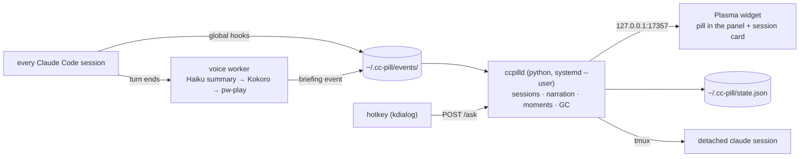

# cc-pill for Linux · KDE Plasma 6

The same living pill, in your Plasma panel. Every Claude Code session at a glance, cats taking laps while Claude works, a paw when it needs you, and a local neural voice that briefs you when each turn finishes.

```sh
git clone https://github.com/ambasoma/cc-pill
cd cc-pill
./linux/setup.sh
```

Then right-click your panel → **Add Widgets…** → search **cc-pill** and drop it in. The pill stays hidden until a Claude Code session starts.

## Requirements

- **KDE Plasma 6** (Wayland or X11), with `kpackagetool6`
- **Claude Code** installed and logged in
- `python3` (3.9+, with the `venv` module), `tmux`, `jq`, `systemd` user sessions
- Audio for the voice: PipeWire (`pw-play`) or PulseAudio (`paplay`), or ALSA (`aplay`)

Optional, each one unlocks a courtesy:

| Tool | What it adds | Install |
| --- | --- | --- |
| [gum](https://github.com/charmbracelet/gum) | The setup TUI (plain prompts otherwise) | charm repo / `pacman -S gum` |
| `kdialog` | The ask-mode prompt box (falls back to `zenity`) | `kdialog` package |
| `playerctl` | Ducks your music while the voice speaks (MPRIS) | `playerctl` package |
| [kdotool](https://github.com/jinliu/kdotool) | Stays silent when that session's terminal is already focused; raises terminals from the card | from source |

Setup prints the right `apt` / `dnf` / `pacman` / `zypper` line for anything missing.

## How it's put together

On macOS the pill is one Swift process. On Linux it is split in two so any desktop can render it:



- **`linux/daemon/ccpilld.py`** is the brain: a one-for-one port of the Swift `Store` (session states, needs-you filtering, narration cadence, bloom timing, star and sad moments, dead-process reaping, idle pill-session GC). Stdlib only. Run as the `cc-pill.service` user unit.
- **`linux/plasmoid/com.ccpill.pill`** is the renderer: a QML-only Plasma 6 applet. Compact representation is the pill, full representation is the card. It polls the daemon twice a second and draws everything from that state.
- **`voice/`** is shared with macOS. The worker picks `afplay` or `pw-play`/`paplay`/`aplay`, `media-control` or `playerctl`, `lsappinfo` or `kdotool` based on the platform.
- **`linux/bin/ccpill-ask`** is ask mode: a `kdialog` box bound to a KDE global shortcut (default <kbd>Meta</kbd><kbd>Alt</kbd><kbd>M</kbd>), posting to the daemon.

## The daemon's API

Localhost only. Every request must carry the header `X-CC-Pill: 1`, and any request with an `Origin` header is refused, so a web page in your browser cannot drive the pill.

| Route | Body | Does |
| --- | --- | --- |
| `GET /state` | | The whole renderer state: `pill`, `sessions`, `briefing`, `moment`, `voice`, `toast`, daemon clock `t` |
| `POST /ask` | `{"text"}` | Start a hands-free session in `home_repo` with the prompt |
| `POST /recap` | `{"sid"}` | Replay that session's last briefing |
| `POST /prompt` | `{"sid","text"}` | Type a prompt into that session's tmux pane |
| `POST /terminal` | `{"sid"}` | Switch/raise/open the terminal for that session |
| `POST /mute` | | Toggle the voice, returns `{"muted"}` |
| `POST /stop` | | Cut the current speech |

```sh
curl -s -H 'X-CC-Pill: 1' localhost:17357/state | jq .pill
```

The same state is mirrored to `~/.cc-pill/state.json` on every change, for status bars and scripts that would rather read a file.

## Look

By default the widget looks like any other panel widget: the panel's font and
text colour, the colour scheme's accent for working sessions, its "neutral"
colour (orange in Breeze) for a session that needs you, its "positive" colour
for done, a Breeze check or warning at the end of a turn, and no capsule.
Switching the Plasma colour scheme restyles it instantly.

The widget keeps one width while sessions run: the words live in a slot of a
fixed number of characters (22 by default, adjustable in the widget settings).
New text slides in the way the Mac pill swaps its narration and text wider
than the slot glides sideways to show its tail. Neighbouring panel widgets
never get shoved.

At the end of a turn the voice worker turns the session's last message into
a one-to-three-sentence briefing (Haiku), speaks it, and the pill blooms: a
small window hangs off the panel under the pill (above it for a bottom
panel) with the whole briefing, words lighting up as they are spoken, and
goes away a few seconds after the voice stops. It is a tooltip-type window,
so it never takes keyboard focus from your terminal. The Appearance page can
instead widen the pill to fit the briefing, as on the Mac, or crawl it
through the text slot. The card keeps each session's last briefing under
its row, and the play button speaks it again.

Right-click the widget → *Configure…* for three pages:

- **General**: text width; activation (open the card on click, or when the
  pointer rests on the widget for a delay you set; extra hit area around the
  pill); the daemon port; the cats (off by default).
- **Appearance**: the look (**Plasma**, or **Porcelain**: the macOS cc-pill
  pill, cream by day, kiln at night, sun and moon, tapping paw); how a
  briefing shows (bloom window, widen the pill, crawl in the slot); the font (the
  panel's, or any font, size, weight and italic from a font dialog); the
  colours (follow the scheme, or custom text, accent, needs-you, done,
  capsule fill and border colours); a tinted capsule behind the words; the
  border width and the corner radius.
- **Placement**: pick a panel edge (top, bottom, left, right) and a position
  (left, centre between two spacers, or right before the system tray) and
  press *Move*. See below.

## Placement

The pill is a panel widget, so Plasma's own way always works: right-click a
panel → *Enter Edit Mode*, drag the widget anywhere on any panel, or add two
*Panel Spacers* around it to centre it. A panel that also holds an expanding
task manager shares its free space with the spacers, so a true centre needs
the task manager on another panel or the pill next to the clock instead.

Setup asks where the pill should live, and the widget's *Placement* page does
the same later. Both run `linux/bin/cc-pill-place`:

```sh
linux/bin/cc-pill-place --edge top --align center      # also: bottom/left/right, start/end
linux/bin/cc-pill-place --status
```

It drives plasmashell over D-Bus: a new pill is added to the chosen panel (a
panel is created at that edge if there is none, and removed again when the
pill leaves it), your settings are copied over, the old pill goes away, and
"centre" brackets the pill with two spacers. Plasma reads a panel's widget
order only at startup, so when the pill has to go anywhere but the end of the
panel the shell restarts for a couple of seconds. A vertical panel shows the
dots only; the words and the card are a click away.

## Config

`~/.cc-pill/config.json`, written by setup. Linux-specific keys:

| Key | Default | Meaning |
| --- | --- | --- |
| `terminal` | `konsole` | Terminal command for the card's open-terminal button (`konsole`, `kitty`, `alacritty`, `wezterm`, `ghostty`, `foot`, `gnome-terminal`, `xterm`, or any command that takes `-e`) |
| `daemon_port` | `17357` | Port the daemon binds on 127.0.0.1. Change the widget's port in its settings to match |
| `hotkey` | `meta+alt+m` | Ask-mode shortcut (written to KDE global shortcuts by setup) |

Everything else (`name`, `voice`, `speed`, `volume`, `home_repo`, `permission_mode`, `pill_system_prompt`, `pill_gc_minutes`, `summarizer_model`) means the same as on macOS.

## Controls

| Control | What it does |
| --- | --- |
| <kbd>Meta</kbd><kbd>Alt</kbd><kbd>M</kbd> (your choice) | Ask mode: a prompt box; <kbd>Enter</kbd> starts a detached session that is tracked and briefed. |
| Hover the pill | Tooltip with the session summary, or the card itself with *open on hover* in the settings. |
| Click the pill | The card: one row per session with replay-briefing, send-a-prompt and open-terminal buttons, `+ NEW`, and the mute toggle. |
| `<yourname>` in the shell | `mute`, `on`, `stop`, `last`, `say <text>`, `voice <name>`, `vol`, `speed`. |

## Troubleshooting

```sh
systemctl --user status cc-pill          # is the daemon up
journalctl --user -u cc-pill -n 50        # its stderr
tail -f ~/.cc-pill/pill.log               # every event it applied
tail -f <install>/voice/spool/voice.log   # what the voice said, or why it stayed quiet
```

- **Widget shows nothing.** It hides itself when there are no sessions. Start `claude` somewhere; a dot appears. If the tooltip says the daemon isn't running, see the service status above.
- **Widget port mismatch.** Right-click the widget → Configure → Daemon port must equal `daemon_port` in the config.
- **Card buttons do nothing for your own sessions.** Prompt-send and open-terminal need the session inside tmux: accept the tmux wrapper in setup, then open a new shell.
- **No audio.** `pw-play`, `paplay` or `aplay` must be on the PATH of the voice worker (which runs from the Claude Code hook, in your login environment).
- **Hotkey doesn't fire.** System Settings → Shortcuts → look for *cc-pill: Ask* and assign it there. Setup registers it through `kglobalshortcutsrc` and the `.desktop` file's `X-KDE-Shortcuts`; a fresh login always picks it up.
- **Terminal doesn't come to the front.** Wayland lets only the compositor raise windows. Install `kdotool`; without it the daemon opens a new terminal window attached to the tmux session instead.
- **After upgrading the widget**, restart the shell: `systemctl --user restart plasma-plasmashell`.

## Known gaps versus macOS

- **No voice input in ask mode.** Apple's dictation has no drop-in equivalent; ask mode is typed. Whisper-based dictation is a candidate for a later version.
- **No notch mode.** The pill lives in the panel; the panel's height sets the pill's height.
- **Hover does not open the card.** Plasma popups open on click; hover shows the tooltip.
- Verified so far in a Multipass VM (Ubuntu 26.04, Plasma 6.6, Frameworks 6.24) with `plasmoidviewer` under Xvfb and the real
  `linux/setup.sh`: every pill state, both colour schemes, the card and its actions, the systemd service, hooks and hotkey
  registration. Not yet exercised: a real panel in a live plasmashell session (panel heights, the Wayland global shortcut)
  and audio playback and ducking. See the QA checklist in the project tracker.

## Developing

```sh
python3 -m unittest discover linux/daemon/tests        # daemon tests (no tmux, no audio needed)
CC_PILL_HOME=/tmp/pill python3 linux/daemon/ccpilld.py # run against a scratch data dir
kpackagetool6 --type Plasma/Applet --upgrade linux/plasmoid/com.ccpill.pill && systemctl --user restart plasma-plasmashell
```

MIT, like the rest of cc-pill.
